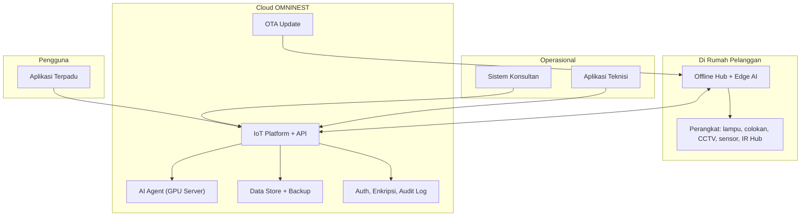

# Software Requirements Specification (SRS)
## OMNINEST Smart Home

Versi 1.0 | Program Studi Teknologi Informasi, UMY | 2026

---

## 1. Pendahuluan

### 1.1 Tujuan
Dokumen ini menetapkan spesifikasi kebutuhan perangkat lunak untuk ekosistem OMNINEST Smart Home, yaitu aplikasi terpadu untuk mengontrol perangkat rumah pintar, AI Agent otomasi, layanan konsultasi, serta layanan instalasi dan maintenance. Dokumen ini dipakai sebagai bukti work product penilaian Capability Level 2 (pengelolaan definisi kebutuhan) dan sebagai acuan bersama bagi seluruh pemangku kepentingan.

### 1.2 Ruang Lingkup
OMNINEST adalah perusahaan teknologi penyedia ekosistem smart home yang memadukan AI dan IoT. Lingkup SRS ini meliputi:

- Aplikasi pengguna (satu pintu) untuk memantau dan mengontrol perangkat dari jarak jauh
- AI Agent yang mengotomatisasi perangkat berdasarkan pola penggunaan
- Local Automation Engine dan Offline Hub untuk operasi tanpa internet
- Dasbor energi dan dasbor keamanan
- Sistem konsultasi untuk rekomendasi perangkat
- Sistem layanan teknisi (penugasan, laporan kerusakan, riwayat perangkat)

Di luar lingkup: desain hardware perangkat dan proses manufaktur.

### 1.3 Definisi dan Istilah

| Istilah | Definisi |
|---|---|
| SRS | Software Requirements Specification |
| IoT | Internet of Things, perangkat yang saling terhubung lewat jaringan |
| AI Agent | Sistem cerdas yang mempelajari kebiasaan pengguna untuk mengotomatisasi rumah |
| Offline Hub | Pusat kendali lokal agar sistem tetap berjalan saat internet terputus |
| OTA | Over-The-Air, pembaruan perangkat lunak jarak jauh |
| MoSCoW | Metode prioritas: Must, Should, Could, Won't |
| FR / NFR | Kebutuhan fungsional / non-fungsional |
| KS | Kode kebutuhan stakeholder pada dokumen ini |

### 1.4 Referensi
- Laporan Strategic Alignment OMNINEST (pemetaan misi ke BSC dan EG, matriks SWOT, strategi bisnis-SI-TI versi 1.0 dan 2.0, target pengembangan tahun 1 sampai 3)
- Company profile OMNINEST Smart Home (visi, misi, filosofi logo)
- COBIT 2019, praktik BAI02 (Managed Requirements Definition)

## 2. Stakeholder dan Kebutuhan Stakeholder

### 2.1 Daftar Stakeholder

| ID | Stakeholder | Peran / Kepentingan |
|---|---|---|
| S1 | Pelanggan (pemilik rumah) | Pengguna utama, segmen menengah ke atas perkotaan |
| S2 | Anggota keluarga pelanggan | Pengguna dengan hak akses terbatas |
| S3 | Konsultan | Survei rumah dan rekomendasi perangkat |
| S4 | Teknisi lapangan | Instalasi, perawatan, perbaikan |
| S5 | Tim R&D dan AI | Pengembangan produk dan AI Agent |
| S6 | Manajemen OMNINEST | Pengendalian biaya, risiko, dan kepatuhan |
| S7 | Investor / modal ventura | Pendanaan dan pertumbuhan bisnis |
| S8 | Vendor / pabrikan lokal | Pemasok perangkat |
| S9 | Developer perumahan | Mitra B2B (target tahun 3) |

### 2.2 Kebutuhan dan Prioritas (MoSCoW)

| ID | Stakeholder | Kebutuhan | Sumber | Prioritas |
|---|---|---|---|---|
| KS-01 | S1 | Mengontrol dan memantau semua perangkat lewat satu aplikasi dari jarak jauh | Misi 1 | Must |
| KS-02 | S1 | AI Agent yang mengotomatisasi perangkat sesuai kebiasaan pengguna | Misi 2 | Must |
| KS-03 | S1, S2 | Pengaturan privasi dan hak akses per anggota keluarga, serta log aktivitas | Misi 7 | Must |
| KS-04 | S3 | Memasukkan data karakteristik rumah dan mendapat rekomendasi perangkat otomatis | Misi 3 | Must |
| KS-05 | S4 | Menerima perintah kerja dan melaporkan status perbaikan dari lokasi pelanggan | Misi 4 | Must |
| KS-06 | S6 | Mencatat riwayat pemakaian alat, laporan eror, dan jadwal penugasan teknisi | Misi 4 | Must |
| KS-07 | S1 | Sistem tetap berjalan saat internet atau listrik terputus (Offline Hub) | Strategi SI/TI v2.0 | Should |
| KS-08 | S1 | Dasbor konsumsi listrik harian beserta saran penghematan | Misi 5 | Should |
| KS-09 | S1 | Pembaruan perangkat lunak otomatis lewat OTA | Strategi SI/TI v2.0 | Should |
| KS-10 | S5 | Data pola aktivitas terekam aman untuk melatih AI Agent | Misi 2 | Should |
| KS-11 | S6 | Biaya operasional dan risiko pengembangan terkendali | Misi 6 | Should |
| KS-12 | S7, S8 | Kemitraan vendor lokal dan peluang pendanaan | Strategi bisnis v2.0 | Could |
| KS-13 | S9 | Paket bundling sistem smart home untuk developer perumahan | Target tahun 3 | Could |
| KS-14 | S4, S5 | Peningkatan keahlian teknisi dan tim R&D secara berkelanjutan | Misi 8 | Could |

### 2.3 Acceptance Criteria

> Angka di bawah adalah usulan awal dan perlu disepakati bersama stakeholder.

| ID | Kriteria Penerimaan |
|---|---|
| KS-01 | Semua jenis perangkat (lampu, colokan, CCTV) tampil dan dapat dikontrol dari satu aplikasi; perintah tereksekusi maksimal 3 detik |
| KS-02 | AI Agent menjalankan minimal satu rutinitas otomatis berdasarkan pola yang dipelajari, dan pengguna bisa menonaktifkannya |
| KS-03 | Pemilik dapat mengatur hak akses per anggota; setiap akses ke CCTV tercatat di log aktivitas |
| KS-04 | Setelah data rumah diisi, sistem menghasilkan daftar rekomendasi perangkat beserta alasannya |
| KS-05 | Teknisi dapat menerima, memperbarui status, dan menutup perintah kerja dari aplikasi |
| KS-06 | Setiap laporan eror dan penugasan teknisi tersimpan beserta riwayatnya dan bisa dicari |
| KS-07 | Saat internet terputus, minimal rutinitas otomatis dasar tetap berjalan lewat Offline Hub |
| KS-08 | Grafik konsumsi listrik harian tampil dan menampilkan minimal satu saran penghematan |
| KS-09 | Pengguna menerima notifikasi pembaruan dan pembaruan terpasang tanpa mengganti perangkat |
| KS-10 | Data aktivitas terenkripsi dan terpisah antar pelanggan |
| KS-11 | Estimasi biaya dan register risiko tersedia dan ditinjau berkala oleh manajemen |
| KS-12 | Minimal satu calon vendor lokal teridentifikasi dan dievaluasi |
| KS-13 | Paket bundling terdokumentasi dan dapat ditawarkan ke developer |
| KS-14 | Rencana pelatihan tersedia untuk teknisi dan tim R&D |

### 2.4 Riwayat Revisi

| Versi | Tanggal | Penulis | Perubahan |
|---|---|---|---|
| 1.0 | 25 November 2026 | Kelompok OMNINEST | Draft awal: pendahuluan dan kebutuhan stakeholder |

> Kebutuhan dapat berubah dan makin rinci seiring implementasi. Setiap perubahan dicatat pada tabel ini.

## 3. Kebutuhan Bisnis dan Gap Analysis

### 3.1 Kondisi Saat Ini vs yang Diinginkan

| Area Kapabilitas | Kondisi Saat Ini (As-Is) | Kondisi yang Diinginkan (To-Be) | Cara Menutup Kesenjangan | KS |
|---|---|---|---|---|
| Kontrol perangkat | Pengguna memakai banyak aplikasi berbeda, kontrol manual | Satu aplikasi terpadu untuk seluruh perangkat | Aplikasi satu pintu dengan platform IoT berbasis cloud dan API | KS-01 |
| Otomasi | Rutinitas diatur manual oleh pengguna | AI Agent mempelajari kebiasaan dan mengotomatisasi rumah | Pengumpulan data pola aktivitas dan fitur AI Subscription | KS-02, KS-10 |
| Ketersediaan layanan | Fungsi rumah pintar bergantung pada internet | Tetap berjalan saat internet atau listrik terputus | Offline Hub, Local Automation Engine, baterai cadangan | KS-07 |
| Konsultasi | Pelanggan memilih perangkat sendiri tanpa panduan | Rekomendasi perangkat sesuai tata letak rumah | Sistem digital konsultan dengan rekomendasi otomatis | KS-04 |
| Layanan teknisi | Penugasan dan laporan kerusakan belum terpusat | Penugasan, riwayat, dan status perbaikan tercatat terpusat | Aplikasi teknisi dan sistem pencatatan riwayat alat | KS-05, KS-06 |
| Penghematan energi | Pengguna tidak melihat konsumsi listrik per perangkat | Dasbor konsumsi harian dan saran penghematan | Sensor daya pintar dan dasbor Energy Monitoring | KS-08 |
| Keamanan dan privasi | Kekhawatiran data CCTV dan aktivitas rumah bocor | Kepercayaan pelanggan atas keamanan data | Enkripsi, kontrol akses, audit log, Security Dashboard | KS-03 |
| Umur produk | Perangkat cepat usang saat standar baru muncul | Perangkat tetap relevan lewat pembaruan | Sistem pembaruan OTA | KS-09 |

> Kolom "Kondisi Saat Ini" adalah asumsi kondisi awal pasar dan perusahaan sebelum peluncuran. Sesuaikan kalau tim punya data yang berbeda.

### 3.2 Use Case dan User Story

**Aktor:** Pelanggan, Anggota Keluarga, Konsultan, Teknisi, Admin OMNINEST.

| ID | Use Case | Aktor | Deskripsi Singkat |
|---|---|---|---|
| UC-01 | Mengontrol perangkat | Pelanggan | Melihat status dan menyalakan/mematikan perangkat dari jarak jauh |
| UC-02 | Mengatur otomasi AI | Pelanggan | Mengaktifkan, mengubah, atau menonaktifkan rutinitas yang disarankan AI Agent |
| UC-03 | Mengelola hak akses | Pelanggan | Menentukan anggota keluarga mana yang boleh mengatur perangkat tertentu |
| UC-04 | Melihat konsumsi energi | Pelanggan | Membuka grafik konsumsi listrik dan saran penghematan |
| UC-05 | Membuat rekomendasi perangkat | Konsultan | Memasukkan data rumah lalu menerima rekomendasi perangkat |
| UC-06 | Melaporkan kerusakan | Pelanggan | Mengirim laporan eror perangkat ke layanan teknisi |
| UC-07 | Menangani perintah kerja | Teknisi | Menerima, memperbarui, dan menutup perintah kerja di lokasi |
| UC-08 | Menugaskan teknisi | Admin | Menjadwalkan dan menugaskan teknisi untuk laporan kerusakan |
| UC-09 | Memperbarui perangkat lunak | Pelanggan | Menerima notifikasi dan memasang pembaruan OTA |

**User story:**

- Sebagai **pelanggan**, saya ingin mengontrol semua perangkat dari satu aplikasi agar tidak perlu membuka banyak aplikasi. (KS-01)
- Sebagai **pelanggan**, saya ingin AI Agent menjalankan rutinitas sesuai kebiasaan saya agar rumah bekerja otomatis. (KS-02)
- Sebagai **pemilik rumah**, saya ingin membatasi akses anggota keluarga agar privasi dan keamanan terjaga. (KS-03)
- Sebagai **konsultan**, saya ingin memasukkan data rumah dan langsung mendapat rekomendasi agar survei lebih cepat. (KS-04)
- Sebagai **teknisi**, saya ingin menerima perintah kerja di aplikasi agar bisa melapor langsung dari lokasi. (KS-05)
- Sebagai **pelanggan**, saya ingin melihat konsumsi listrik harian agar bisa menekan tagihan. (KS-08)

## 4. Spesifikasi Kebutuhan

### 4.1 Kebutuhan Fungsional (FR)

| ID | Kebutuhan Fungsional | KS | Prioritas |
|---|---|---|---|
| FR-01 | Sistem menampilkan daftar dan status seluruh perangkat pengguna | KS-01 | Must |
| FR-02 | Sistem memungkinkan kontrol perangkat (on/off, pengaturan) dari jarak jauh | KS-01 | Must |
| FR-03 | Sistem menyediakan registrasi, login, dan manajemen akun | KS-03 | Must |
| FR-04 | Sistem mengatur hak akses per anggota keluarga untuk tiap perangkat | KS-03 | Must |
| FR-05 | Sistem mencatat log aktivitas, termasuk akses ke CCTV | KS-03 | Must |
| FR-06 | AI Agent merekam pola penggunaan dan menyarankan rutinitas otomatis | KS-02, KS-10 | Must |
| FR-07 | Pengguna dapat menyetujui, mengubah, atau menonaktifkan rutinitas AI | KS-02 | Must |
| FR-08 | Sistem menerima data karakteristik rumah dan menghasilkan rekomendasi perangkat | KS-04 | Must |
| FR-09 | Pengguna dapat mengirim laporan kerusakan perangkat | KS-06 | Must |
| FR-10 | Admin dapat menjadwalkan dan menugaskan teknisi | KS-06 | Must |
| FR-11 | Teknisi dapat menerima perintah kerja dan memperbarui statusnya | KS-05 | Must |
| FR-12 | Sistem menyimpan riwayat pemakaian dan perbaikan tiap perangkat | KS-06 | Should |
| FR-13 | Local Automation Engine menjalankan rutinitas dasar saat internet terputus | KS-07 | Should |
| FR-14 | Sistem menampilkan grafik konsumsi listrik harian dan saran penghematan | KS-08 | Should |
| FR-15 | Sistem menotifikasi dan mendistribusikan pembaruan OTA | KS-09 | Should |
| FR-16 | Sistem mendukung pembayaran langganan AI Subscription | KS-02 | Could |

### 4.2 Kebutuhan Non-Fungsional (NFR)

| ID | Kategori | Kebutuhan | KS |
|---|---|---|---|
| NFR-01 | Keamanan | Data dienkripsi saat transit dan saat disimpan | KS-03, KS-10 |
| NFR-02 | Privasi | Data antar pelanggan terisolasi; kepatuhan terhadap regulasi pelindungan data pribadi | KS-03, KS-10 |
| NFR-03 | Ketersediaan | Fungsi inti tetap berjalan saat internet terputus (offline) | KS-07 |
| NFR-04 | Kinerja | Perintah kontrol perangkat tereksekusi maksimal 3 detik (usulan) | KS-01 |
| NFR-05 | Usability | Pengguna baru dapat menyambungkan dan mengontrol perangkat pertama tanpa bantuan teknisi | KS-01 |
| NFR-06 | Skalabilitas | Arsitektur mendukung penambahan lini produk dan skala B2B (gedung, hotel) | KS-13 |
| NFR-07 | Keandalan | Backup data otomatis dan audit log sistematis | KS-03 |
| NFR-08 | Kompatibilitas | Mendukung protokol Wi-Fi dan Zigbee serta integrasi perangkat lama lewat Smart IR Hub | KS-01 |
| NFR-09 | Pemeliharaan | Pembaruan dapat didistribusikan tanpa mengganti perangkat keras | KS-09 |

### 4.3 Kebutuhan Data

| Entitas | Atribut Utama |
|---|---|
| Pengguna | id, nama, email, peran, status langganan |
| Rumah | id, pemilik, alamat, tata letak/ruangan |
| Perangkat | id, jenis, ruangan, status, versi firmware |
| Hak Akses | pengguna, perangkat, level akses |
| Log Aktivitas | waktu, pengguna, perangkat, aksi |
| Pola Aktivitas | pengguna, perangkat, waktu, kebiasaan terdeteksi |
| Rutinitas Otomatis | id, pemicu, aksi, status aktif |
| Konsumsi Energi | perangkat, waktu, daya (kWh) |
| Rekomendasi | rumah, konsultan, daftar perangkat, alasan |
| Laporan Kerusakan | id, perangkat, deskripsi, status |
| Perintah Kerja | id, laporan, teknisi, jadwal, status |

> Kalau mau lebih kuat sebagai bukti, tambahkan ERD (gambar) di bagian ini.

### 4.4 UI/UX dan Wireframe

Daftar layar utama berdasarkan use case:

| Layar | Pengguna | Isi Utama | UC |
|---|---|---|---|
| Beranda | Pelanggan | Daftar perangkat per ruangan, status, tombol kontrol cepat | UC-01 |
| Otomasi AI | Pelanggan | Daftar rutinitas yang disarankan, toggle aktif/nonaktif | UC-02 |
| Keamanan & Privasi | Pelanggan | Hak akses anggota, log aktivitas CCTV | UC-03 |
| Energi | Pelanggan | Grafik konsumsi harian, saran penghematan | UC-04 |
| Form Konsultasi | Konsultan | Input data rumah, hasil rekomendasi | UC-05 |
| Laporan Kerusakan | Pelanggan | Form laporan, status penanganan | UC-06 |
| Perintah Kerja | Teknisi | Daftar tugas, detail, tombol update status | UC-07 |

Wireframe: *(tambahkan link Figma atau gambar wireframe di sini)*

## 5. Lingkup, Batasan, dan Rencana Pengembangan

### 5.1 Arsitektur (Bisnis, SI, TI)

Arsitektur disusun dengan framework Ward and Peppard (strategi bisnis, SI, dan TI) dan mengacu pada Strategi Versi 2.0 di laporan Strategic Alignment.

| Lapisan | Komponen Utama | KS |
|---|---|---|
| **Bisnis** | Ekosistem perangkat terintegrasi, AI Agent berlangganan bulanan, konsultasi dan survei, instalasi dan maintenance, penghematan energi, jaminan keamanan data, kemitraan vendor dan teknisi | KS-01 s.d. KS-13 |
| **Sistem Informasi** | Aplikasi terpadu pengguna, sistem pengolah data pola aktivitas, sistem digital konsultan, sistem riwayat alat dan penugasan teknisi, aplikasi teknisi, dasbor energi, Security Dashboard, Local Automation Engine, Software Update System | KS-01 s.d. KS-10 |
| **Teknologi** | Platform IoT berbasis cloud dan API, protokol Zigbee/Wi-Fi, server GPU dan data center, Offline Hub dengan Edge Computing, sensor daya pintar, enkripsi berlapis, firewall, backup otomatis, pipeline OTA | NFR-01 s.d. NFR-09 |

Gambaran arsitektur tingkat tinggi:

### 5.2 Timeline 3 Tahun

| Tahun | Target Pengembangan |
|---|---|
| **Tahun 1** | Peluncuran perangkat dasar (lampu, colokan, CCTV), aplikasi v1.0 (kontrol manual), dan layanan instalasi rumah. Penambahan lini produk (kunci pintar, sensor, robot vacuum) dan perekaman data rutinitas awal. Beta terbatas AI Agent. Perbaikan bug, penyiapan gerbang pembayaran, dan rekrutmen teknisi. |
| **Tahun 2** | Peluncuran resmi dan monetisasi AI Subscription. Dasbor Energy Monitoring dengan notifikasi dan saran penghematan. Produk Smart IR Hub untuk integrasi perangkat lama. Ekspansi B2B lewat paket bundling untuk developer perumahan. |
| **Tahun 3** | Fitur Predictive Maintenance. Aplikasi manajemen skala besar (gedung perkantoran dan perhotelan). Perangkat OMNINEST Offline Hub. Ekspansi ke luar daerah dan uji coba integrasi panel surya. |

### 5.3 Batasan dan Asumsi

| Jenis | Keterangan |
|---|---|
| Lingkup | Fokus perangkat lunak dan layanan; desain hardware dikerjakan bersama vendor |
| Waktu | Mengikuti roadmap 3 tahun di 5.2 |
| Anggaran | Dibatasi oleh pendanaan awal dan suntikan investor (lihat 5.4) |
| Teknis | Ketergantungan pada koneksi internet (dimitigasi lewat Offline Hub), kompatibilitas Zigbee/Wi-Fi |
| Regulasi | Kepatuhan pada regulasi pelindungan data pribadi dan kebijakan internal keamanan |
| SDM | Ketersediaan AI Engineer, pakar siber, dan teknisi lapangan |

### 5.4 Estimasi Anggaran

> **Angka belum diisi.** Isi bersama tim berdasarkan riset harga (jangan asal angka, siapkan sumbernya).

| Komponen Biaya | Tahun 1 | Tahun 2 | Tahun 3 | Dasar Estimasi |
|---|---|---|---|---|
| Pengembangan aplikasi dan AI (SDM R&D) | Rp ... | Rp ... | Rp ... | |
| Server cloud, GPU, dan data center | Rp ... | Rp ... | Rp ... | |
| Produksi perangkat (vendor lokal) | Rp ... | Rp ... | Rp ... | |
| Keamanan dan kepatuhan (audit, enkripsi) | Rp ... | Rp ... | Rp ... | |
| Teknisi dan pelatihan | Rp ... | Rp ... | Rp ... | |
| Pemasaran dan ekspansi | Rp ... | Rp ... | Rp ... | |
| Cadangan risiko (contingency) | Rp ... | Rp ... | Rp ... | |
| **Total** | Rp ... | Rp ... | Rp ... | |

Sumber dana: modal awal, investor / modal ventura, pendapatan langganan AI (mulai Tahun 2).

## 6. Analisis Solusi Alternatif

### 6.1 Perbandingan Alternatif

Tiga keputusan utama dikaji bersama stakeholder (R&D, manajemen, operasional, investor):

**Keputusan 1: Arsitektur pemrosesan AI**

| Alternatif | Kelebihan | Kekurangan |
|---|---|---|
| A. Cloud-only | Sederhana, mudah diperbarui | Mati total saat internet putus, latensi, risiko privasi |
| B. Hybrid Cloud + Edge (Offline Hub) | Tetap jalan saat offline, data sensitif diproses lokal | Biaya hardware dan kompleksitas lebih tinggi |
| C. Edge-only | Privasi dan kecepatan tinggi | Kemampuan AI terbatas, sulit di-update dan dikembangkan |

**Keputusan 2: Pengadaan perangkat**

| Alternatif | Kelebihan | Kekurangan |
|---|---|---|
| A. Manufaktur sendiri | Kendali penuh kualitas | Modal besar, butuh waktu lama |
| B. OEM / vendor lokal | Biaya terkendali, bebas risiko kurs | Bergantung kualitas vendor |
| C. Impor | Pilihan produk luas | Terpengaruh fluktuasi kurs dan bea masuk |

**Keputusan 3: Tenaga teknisi**

| Alternatif | Kelebihan | Kekurangan |
|---|---|---|
| A. Teknisi internal saja | Kualitas dan standar terjaga | Biaya tetap tinggi, sulit berekspansi |
| B. Mitra tersertifikasi saja | Cepat berekspansi, biaya fleksibel | Kualitas layanan sulit dikontrol |
| C. Hybrid (internal inti + mitra tersertifikasi) | Seimbang antara kualitas dan jangkauan | Butuh program sertifikasi dan koordinasi |

### 6.2 Kriteria Kelayakan, Risiko, dan Biaya

Skala 1 sampai 5 (5 = paling baik; untuk biaya, 5 = paling murah; untuk risiko, 5 = paling rendah). Bobot: Kelayakan teknis 30%, Biaya 25%, Risiko 25%, Kesesuaian strategi 20%.

> Skor adalah usulan awal dan perlu disepakati tim.

| Keputusan | Alternatif | Teknis (30%) | Biaya (25%) | Risiko (25%) | Strategi (20%) | **Skor** |
|---|---|---|---|---|---|---|
| 1. Arsitektur AI | A. Cloud-only | 5 | 4 | 2 | 2 | 3,40 |
| | B. Hybrid | 4 | 3 | 4 | 5 | **3,95** |
| | C. Edge-only | 2 | 2 | 3 | 3 | 2,45 |
| 2. Pengadaan | A. Manufaktur sendiri | 2 | 1 | 2 | 3 | 1,95 |
| | B. OEM / vendor lokal | 4 | 3 | 4 | 4 | **3,75** |
| | C. Impor | 4 | 3 | 2 | 2 | 2,85 |
| 3. Teknisi | A. Internal saja | 4 | 2 | 4 | 3 | 3,30 |
| | B. Mitra saja | 3 | 4 | 2 | 3 | 3,00 |
| | C. Hybrid | 4 | 3 | 4 | 4 | **3,75** |

Penilaian kelayakan:
- **Teknis**: Edge Computing dan Offline Hub sudah tercantum di strategi TI v2.0.
- **Ekonomi**: biaya dikaji di 5.4; hybrid dan vendor lokal menekan biaya modal awal.
- **Operasional**: program sertifikasi teknisi mendukung ekspansi urban.

### 6.3 Keputusan Pemilihan Solusi

| Keputusan | Solusi Terpilih | Alasan |
|---|---|---|
| Arsitektur AI | **Hybrid Cloud + Edge** | Skor tertinggi; menjamin ketersediaan saat offline dan sesuai nilai jual keamanan |
| Pengadaan perangkat | **OEM / vendor lokal** | Menghindari risiko kurs dan menekan ketergantungan pihak ketiga luar negeri |
| Tenaga teknisi | **Hybrid internal + mitra tersertifikasi** | Menyeimbangkan kualitas layanan dengan kecepatan ekspansi |

Keputusan ditetapkan melalui kesepakatan manajemen dan tim (tanggal dan notulen: *isi bila ada*).

## Lampiran

### A. Risk Register

| ID | Risiko | Dampak | Kemungkinan | Mitigasi | Pemilik |
|---|---|---|---|---|---|
| R-01 | Serangan peretas pada server dan data CCTV | Tinggi | Sedang | Enkripsi berlapis, kontrol akses, audit log, pen-test berkala | Tim Keamanan |
| R-02 | Internet atau listrik pelanggan terputus | Tinggi | Tinggi | Offline Hub, Edge AI, baterai cadangan | Tim R&D |
| R-03 | Fluktuasi kurs dan ketergantungan vendor luar negeri | Sedang | Sedang | Vendor lokal, kontrak jangka panjang | Manajemen |
| R-04 | Kekurangan teknisi di area ekspansi | Sedang | Sedang | Program sertifikasi mitra teknisi | Operasional |
| R-05 | Perangkat cepat usang saat standar baru muncul | Sedang | Sedang | Sistem OTA, desain modular | Tim R&D |
| R-06 | Pelanggaran privasi dan regulasi data | Tinggi | Rendah | Kebijakan privasi, isolasi data, kepatuhan regulasi | Manajemen |
| R-07 | Biaya GPU dan data center membengkak | Sedang | Sedang | Pemantauan biaya, Edge Computing, skala bertahap | Keuangan |
| R-08 | Keluarnya SDM ahli (AI Engineer, pakar siber) | Tinggi | Sedang | Program retensi dan pelatihan berkelanjutan | HR |

### B. Riwayat Versi

Lihat tabel riwayat revisi pada bagian 2.4.
